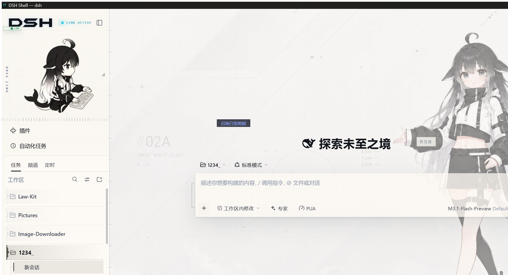

# dsh-shell

A native desktop shell for the [DeepSeek Harness](https://github.com/deepseek-ai/deepseek-harness)
(`dsh`) web UI: a real window instead of a browser tab, and real ownership of the
`dsh` process behind it.



> **Pure shell.** dsh-shell does not modify dsh, does not bundle dsh, and does
> not write a dsh client plugin. It talks to dsh exactly the way a browser does:
> one HTTP origin on `127.0.0.1`.

## Status

Verified on Windows 11 with dsh `0.2.0-rc.2` and WebView2, 2026-10-02.

| | |
|---|---|
| Endpoint resolution (stdout URL line, token, port check) | verified, incl. against real dsh |
| `spawn` mode: fork `dsh web`, wait for the authenticated URL | verified |
| `attach` mode: adopt an already-running dsh, never kill it | verified |
| Shutdown: window close → dsh tree gone → port freed | verified |
| Anti-nest guard (refuses to run inside a harness session) | verified |
| Port-ownership guard (points at `attach` instead of dying) | verified |
| `cargo test` — 38 hermetic tests against `stub-dsh` | green |
| `cargo clippy --all-targets -- -D warnings` | clean |
| `cargo build --release` | clean |
| `.msi` + `.nsis` bundles | built |
| macOS / Linux | core compiles; not exercised |

## Requirements

- **Windows 10+ with the WebView2 Runtime** (preinstalled on Windows 11)
- **Rust 1.78+** — a `.cmd` shim is spawned as `cmd.exe`, which older toolchains
  refuse to do. Current stable is fine.
- A working **dsh**: `dsh --version` prints a version.
  ```powershell
  npm install -g @deepseek-ai/dsh
  ```

Node is *not* required: `cargo-tauri` does the packaging.

## Build

```powershell
cd D:\Development\DSH-Shell\src-tauri
cargo test                 # hermetic; never starts a real dsh
cargo clippy --all-targets -- -D warnings
cargo tauri build          # -> target\release\bundle\{msi,nsis}
```

For a quick run, `cargo run` is enough. There is deliberately **no dev server**:
the window is created in `setup()` with a URL that only exists at runtime, so
`tauri dev` (which wants a `devUrl`) has nothing to load.

## Configuration

`%APPDATA%\deepseek\dsh-shell\config\settings.json`. Written only if you create
it; the defaults below apply when it is missing.

```json
{
  "dsh_binary_path": "C:\\Users\\<you>\\AppData\\Roaming\\npm\\dsh.cmd",
  "launch_mode": "spawn",
  "listen_host": "127.0.0.1",
  "preferred_port": 3080,
  "trusted_hosts": ["127.0.0.1", "localhost"],
  "poll_interval_seconds": 0.5,
  "spawn_timeout_seconds": 120,
  "auto_restart_on_crash": true
}
```

| Field | Meaning |
|---|---|
| `dsh_binary_path` | Absolute path to dsh. Defaults to the npm-global `dsh.cmd` if present, else plain `dsh` on `PATH`. |
| `launch_mode` | `spawn` → fork `dsh web` ourselves. `attach` → adopt an instance that is already running, and never kill it. |
| `listen_host` | Loopback only. dsh refuses `0.0.0.0` and so does the config. |
| `preferred_port` | Passed to `dsh web --port`. `0` lets the OS choose. 3080 is dsh's own default. |
| `trusted_hosts` | Repeated as `--trusted-host <host>`; they feed dsh's `/api` browser-trust fence. |
| `poll_interval_seconds` | How often the liveness probe asks the port. |
| `spawn_timeout_seconds` | How long to wait for dsh's URL line. dsh's Loader can take a while on a cold start, so this is generous. |
| `auto_restart_on_crash` | Accepted for schema compatibility. The shell does not restart dsh: a restart loop would fight the "close the window, dsh dies" contract. |

## How the endpoint is found

This is the part worth reading, because getting it wrong is invisible: the app
starts, logs a URL, and shows you a blank window.

dsh prints exactly one useful line, on **stdout**, and only after its plugin
Loader has fully settled — which is seconds *after* the socket is bound:

```
dsh web: http://127.0.0.1:3080/?token=<launchToken>
```

Three facts from dsh's own source shape the implementation:

1. **`?token=` is mandatory.** `dsh-client-connection`'s `authorizeIndex` serves
   the SPA only for a request carrying a valid `?token=` query (which it trades
   for a `dsh-auth-` cookie and a 303 to `./`) or that cookie. A tokenless URL
   from a port probe gets a 401 and a white window. So "the port answers, let's
   use it" can never work, and the port probe is a log line, not a fallback.
2. **stderr contains loopback URLs that are not the UI.** dsh logs
   `bili: attaching to running proxy at http://127.0.0.1:18787` — its internal
   HTTP proxy. An earlier version of this shell scanned both streams with one
   loose loopback regex and returned that proxy port. Only the `dsh web:` line
   is a URL source now, and the port must be the one we asked for.
3. **The token is per-process.** A URL captured from an earlier dsh is
   worthless, so it is resolved once, against the child we just spawned.

dsh's own output is mirrored into the log with a 40-line tail attached to every
error, because a release build has no console and a silent exit is
indistinguishable from a hang.

## Lifecycle

```
+--------------------+   fork    +-----------+    http    +----------------+
|  DSH Shell (Tauri) | --------> |  dsh web  | ---------> | WebView2 + SPA |
|  placeholder -> dsh|           | cmd.exe + |             |                |
|                    |           | node      |             |                |
+--------------------+           +-----------+             +----------------+
         |                            |
         | window closed              | dsh dies
         v                            v
   terminate the tree by PID      port 3080 released
   (taskkill /PID <n> /T)
```

The tree kill is not optional on Windows. `dsh_binary_path` is a `.cmd` shim, so
what we spawn is `cmd.exe` and the harness is a **grandchild** `node.exe`.
Terminating the direct child kills `cmd.exe` alone: node survives holding the
port, the window is gone, and nothing will ever reap it. This is not
hypothetical — the first live run of this shell left exactly that behind, which
is why `Drop` kills the tree too, synchronously, because `Drop` cannot await.

Closing the window runs `RunEvent::ExitRequested` with `prevent_exit`, shuts dsh
down on the async runtime, then exits. It does *not* use
`WindowEvent::CloseRequested`: blocking the event loop there deadlocks the very
loop that has to service the exit. `panic = "abort"` is also deliberately not
set — abort skips every `Drop`, which is the one way to strand a live dsh.

## Safety rails

The failure that shapes this repo: an earlier agent working here killed the
harness it was running inside, most likely with a name-based kill
(`taskkill /IM node.exe`). So:

- **dsh-shell only ever kills PIDs it spawned itself**, from `child.id()`.
- **It refuses to start inside a harness session.** dsh injects
  `DSH_SESSION_ID` / `DSH_PROFILE` / `DSH_WEB_URL` into every model-facing
  shell call, and scrubs ambient `DSH_*` first, so those variables are a
  reliable signal. A second harness started from inside a session contends for
  the same ports, proxy and session store, and the damage lands on the outer
  session.
- **It refuses to start when the port is already owned**, and tells you to use
  `attach` instead.
- **Tests never start a real dsh.** They drive `stub-dsh`, a test double that
  reproduces the URL line, the 401 fence and the decoy proxy banner.

`AGENTS.md` has the full rules, including how to run the one test that does
touch the real harness.

## Logs

```
%APPDATA%\deepseek\dsh-shell\data\logs\dsh-shell.log.<date>   daily, all builds
%APPDATA%\deepseek\dsh-shell\data\logs\crash.log              startup failures
```

`RUST_LOG=debug` adds dsh's own chatter. Debug builds also print to the console.

## Manual verification

```powershell
$env:RUST_LOG = "info,dsh_shell=debug"
cd D:\Development\DSH-Shell\src-tauri
cargo run
```

1. A window appears immediately showing "Starting dsh…".
2. Within a few seconds the title becomes "DSH Shell — dsh" and the dsh UI
   loads. It is a real UI, not a 401 page.
3. Close the window. Within ~1s dsh is gone and the port is free:
   ```powershell
   Get-NetTCPConnection -State Listen -LocalPort 3080
   ```

If a step fails, the log has the reason and dsh's own output with it.

## Architecture

See [`docs/ARCHITECTURE.md`](docs/ARCHITECTURE.md), and
[`AGENTS.md`](AGENTS.md) for the working rules.

## License

MIT. See [`LICENSE`](LICENSE).
