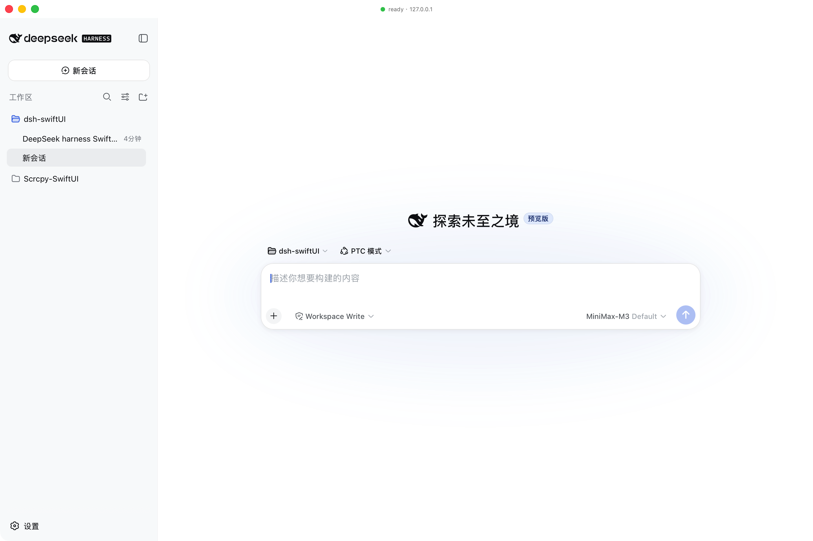

# dsh-swiftUI

A native macOS shell for the [DeepSeek Harness](https://github.com/deepseek-ai/deepseek-harness) (dsh) web UI.

`dsh` ships its product as a CLI that boots a local HTTP server and serves a SPA front-end. `dsh-swiftUI` wraps that experience in a native SwiftUI application: it owns the window, the menu, the lifecycle, and (by default) forks `dsh web` itself. The dsh SPA is rendered inside a `WKWebView`; the native side stays out of dsh's way.

> **Pure shell.** dsh-swiftUI does not modify dsh, does not bundle dsh, and does not write any dsh client plugin. It talks to dsh the same way a browser does: a single HTTP/WebSocket origin on `127.0.0.1`.

This first milestone delivers the **main panel only** — the WKWebView pointing at the dsh SPA, with a transparent titlebar and a floating status badge. The roadmap for future native panels (Git, file tree, in-process terminal) is captured in [`docs/ROADMAP.md`](docs/ROADMAP.md); that work is intentionally deferred.



---

## What works

| Stage | State |
|---|---|
| Repository skeleton + docs | ✅ |
| SwiftPM package + Xcode project (XcodeGen-generated) | ✅ |
| `DSHShellCore` framework — process manager, endpoint resolver, health/attach probes, settings store | ✅ |
| SwiftUI `DSHShell` app — `AppDelegate`-owned `AppCoordinator`, native window, `WKWebView` surface | ✅ |
| `DSHProcessManager` — fork `dsh web`, capture URL, crash-time auto-restart, **clean shutdown via `kill`/`waitpid`** | ✅ |
| `launchMode == .attach` fallback (probe the configured loopback port only) | ✅ |
| App icon, transparent titlebar, floating status badge | ✅ |
| Preferences (binary path, listen host/port, trusted hosts, timeouts, auto-restart) | ✅ |
| dsh **desktop host contract** — `data-platform=darwin` + `dshDesktopBoot` + `dshDesktop` | ✅ real dsh 0.2.0-rc.2: UI boots, 48px top clearance reserved, 4 drag regions, 0 page errors |
| Native window drag from dsh's `[data-window-drag]` rows | ✅ WebKit has no `-webkit-app-region`, so `mousedown` is forwarded to `performWindowDragWithEvent:` |
| Native shortcuts — only the chords dsh actually has bound | ✅ 17 chords across 28 commands; everything else stays with AppKit/WebKit, so ⌘C/⌘V/⌘X and typing still work |
| Device-local shortcut preferences, dsh's real document/edit shapes | ✅ `keybindings.json`, conflict-checked, corrupt files reported not overwritten |
| One-command Release `.app` | ✅ `./scripts/build-app.sh`, ad-hoc signed, arm64 |
| A launch that never leaves "Launching dsh web…" | ✅ was the pipe reader, not dsh — see below |
| dsh's own stdout/stderr in the log, plus a diagnosis on timeout | ✅ previously the log held one line and nothing about dsh |
| Page notifications from dsh plugins (`dsh-notification` etc.) | ✅ via a `Notification` shim — see "Notifications" below |
| Launch smoke test in `build-app.sh` | ✅ catches "builds fine, crashes on launch", which `swift test` structurally cannot |
| Unit tests for `DSHShellCore` | ✅ 155 passing, 0 failing |
| Hermetic lifecycle tests against `stub-dsh` | ✅ 13, every one ends by asserting the port is bindable again |
| Single instance — a second launch raises the window, never fights for the port | ✅ `flock`, checked before anything else |
| Menu-bar status item: show/hide, zoom reset, exit | ✅ carries the connection state; restores the window through the SwiftUI scene, not by hunting for an `NSWindow` that a closed scene no longer owns |
| External links go to the default browser; `target=_blank` handled | ✅ one origin allowed, `http(s)` only |
| Page zoom 50–200% in 10% steps, persisted | ✅ ⌘+/⌘-, status-item submenu listing every rung |
| Daily rotating file log + `crash.log`, dsh's own output included | ✅ `~/Library/Application Support/DSHShell/logs/`; the test suite logs elsewhere so stub output cannot be mistaken for evidence |
| dsh desktop-contract self-check reported to the log | ✅ `platform`, `--dsh-frame-*`, `-webkit-app-region` |
| `swift build` and `xcodebuild` both clean | ✅ 0 errors; both are run by `build-app.sh` because `swift test` alone never compiles the app target |
| Preflight: refuse to nest inside a harness session | ✅ |
| Preflight: refuse a port someone else owns, never kill it | ✅ |
| Preflight: `SO_REUSEADDR` on the port probe | ✅ so `TIME_WAIT` cannot fake a collision |
| Git / File tree / Terminal panels | ⏳ Roadmap only |

---

## Requirements

- **macOS 15+** (built and tested on macOS 27 with the Xcode-beta SDK)
- **Xcode-beta** (the bundled Swift 6.4 toolchain is the target compiler)
- A working **dsh** install — `dsh --version` should print `0.1.0-rc.6` or later.
  ```sh
  npm install -g @deepseek-ai/dsh
  ```
  The first launch needs the dsh front-end dist to be built (`pnpm run build` from the dsh repo). dsh-swiftUI does **not** ship the dsh dist.

If you have multiple Xcode versions installed, `xcode-select -p` may still point at CommandLineTools, which has no `xcodebuild`. Either point it at the beta once:

```sh
sudo xcode-select -s /Applications/Xcode-beta.app/Contents/Developer
```

…or, preferably, leave the global setting alone and set `DEVELOPER_DIR` per command. `build-app.sh` does the latter automatically: pointing `xcode-select` at a beta silently moves every other tool on the machine onto it.

- **xcodegen** — `brew install xcodegen`. `DSHShell.xcodeproj` is generated from `project.yml`; never hand-edit it.

---

## Building

### The deliverable — one command

```sh
./scripts/build-app.sh            # Release .app
./scripts/build-app.sh --debug    # Debug .app
./scripts/build-app.sh --run      # Release, then launch it
```

From a fresh clone, with no manual steps. It runs the syntax check on both injected scripts, regenerates the Xcode project, runs the hermetic test suite, builds Release, and then **verifies the two JS bridges are actually inside the bundle** before reporting success.

```
==> built macos/build/Release/DerivedData/Build/Products/Release/DSHShell.app
    size:      2.2M
    version:   0.2.0
    bundle id: ai.deepseek.dsh-shell
      ok   bridge.js
      ok   dsh_desktop_bridge.js

To run it:
    open ".../DSHShell.app"
```

That last check is not ceremony. `swift build` produces a bare Mach-O executable with no bundle, so `bridge.js` and `dsh_desktop_bridge.js` are simply absent — and a missing `dsh_desktop_bridge.js` does not degrade, it **breaks**: dsh is never told it is on a desktop, so the desktop runtime is never declared and the failure looks like nothing at all. The script fails rather than handing you an app that cannot boot dsh.

**Signing.** The app is ad-hoc signed (`CODE_SIGN_IDENTITY="-"`), so it runs on the machine that built it. There are no Developer ID identities here, so it is not distributable and Gatekeeper will quarantine a copy that arrives from anywhere else. For that case, once:

```sh
xattr -dr com.apple.quarantine /path/to/DSHShell.app
```

**Architecture.** arm64 only. `xcodebuild -destination 'platform=macOS'` matches both arm64 and x86_64 on Apple silicon and then fails inside Swift's prebuilt-module set, on something the project does not control; the script pins `arch=arm64`.

### Working on it — Xcode

```sh
brew install xcodegen              # one-time
xcodegen generate                  # after editing project.yml
open DSHShell.xcodeproj
```

Then ⌘R. The generated **shared scheme is committed**, which is what makes `-scheme DSHShell` work on a fresh clone — so do not gitignore `*.xcscheme`.

### Testing

```sh
swift test      # 155 hermetic tests
swift build     # compiles the app target too — `swift test` does NOT
```

`swift test` only reaches `DSHShellCore`, the bridge shim and `stub-dsh`. It never compiles `Sources/DSHShell`, which is how `Bundle.module` — a SwiftPM-only accessor that does not exist in the Xcode target — survived to the Xcode build. Both commands are part of `build-app.sh` for that reason.

`stub-dsh` can print startup chatter before its URL line (`--chatter-bytes`), which is what makes a launch's dependence on output volume testable rather than anecdotal.

No test boots a real dsh: the lifecycle tests drive `stub-dsh`, a purpose-built test double.

---

## Configuration

Settings live at `~/Library/Application Support/dsh-swiftUI/settings.json`. Defaults:

```json
{
  "dshBinaryPath": "/Users/djx/.npm-global/bin/dsh",
  "launchMode": "spawn",
  "listenHost": "127.0.0.1",
  "preferredPort": 34247,
  "trustedHosts": ["127.0.0.1", "localhost"],
  "pollIntervalSeconds": 0.5,
  "spawnTimeoutSeconds": 60,
  "autoRestartOnCrash": true
}
```

| Field | Meaning |
|---|---|
| `dshBinaryPath` | Absolute path to the `dsh` executable. |
| `launchMode` | `spawn` → fork `dsh web` ourselves; `attach` → only connect to an already-running instance. |
| `listenHost` | Local host passed to `dsh web --host`. `0.0.0.0` is **not** supported (mirrors dsh's own policy). |
| `preferredPort` | Fixed port forwarded to `dsh web --port`. A fixed port lets preflight refuse to start over somebody else's listener instead of killing it, and lets `attach` know where to look. `0` → the flag is omitted entirely and the OS assigns a port. |
| `trustedHosts` | Hosts appended to `dsh web --trusted-host` (repeatable). |
| `spawnTimeoutSeconds` | How long to wait for the `dsh web:` URL line on stdout before failing. Decides success or failure. |
| `spawnStallReportSeconds` | How long dsh may be silent before the log explains what it is doing. **Not** a timeout — the one above still decides. Raise it if your dsh legitimately needs longer to load plugins. |
| `zoomPercent` | Page zoom, 50–200 in steps of 10. See "Zoom" below. |
| `autoRestartOnCrash` | Bounded exponential back-off restart on unexpected child exit: 3 attempts at 2s, 4s and 8s. The counter resets once an endpoint resolves, so a dsh that crashes once an hour is not treated as a crash loop. |

### Zoom

50–200% in 10% steps, on a ladder that lives in exactly one place (`ZoomLadder`) because the menu step, the status-item submenu and the settings file all have to agree.

The ceiling was 100% and nothing was defending it. Measured against real dsh with the probe (`--zoom`):

| zoom | CSS viewport | overflow | breakpoint crossed | page errors |
|---|---|---|---|---|
| 100% | 1280px | none | — | 0 |
| 125% | 1024px | none | — | 0 |
| 150% | 854px | none | ≤900px | 0 |
| 200% | 640px | none | ≤900px, ≤700px | 0 |

Past ~150% you are choosing to read dsh as a small window, not a bigger one — the CSS viewport narrows and dsh reflows. Nothing breaks: no errors, no horizontal overflow, clean boot. `windows/src-tauri/src/config.rs` carries the same ladder.

Reachable three ways: ⌘+/⌘- and ⌘0 in the main menu bar, the **Zoom** submenu of the status item (every rung, check-marked), and the settings field. The submenu lives there rather than in the main menu bar because SwiftUI's main menu bar cannot host a nested menu — a `Menu` is a `View`, not `Commands`.

WebKit's own ⌘+ and ⌘-pinch still work and are not overridden: the shell only pushes a zoom when the preference changed, not on every view update. The previous unconditional write silently undid the page's own zoom on the next state change, which is what made ⌘+ look stuck.

### Notifications

Plugins that raise a system notification (`dsh-notification` and friends) call `new Notification(...)`. In WKWebView that never works, and not for a reason the API makes obvious:

```
Notification.permission            "default"
Notification.requestPermission()   ->  resolves "denied"
Notification.permission            "default"    (unchanged)
new Notification(...)              ->  does not throw, shows nothing
```

WebKit ships the API and has no UI behind it. No prompt appears, ever, so every plugin guarding on `permission === "granted"` is permanently inert — and `dsh-notification` guards on exactly that (`lib/client.js`), returning a failure string nobody ever reads.

So `dsh_desktop_bridge.js` replaces `window.Notification` at document start with one that reports **the app's real macOS authorisation** and forwards each notification to `UNUserNotificationCenter`. The WebKit original is kept as `__dshShellWebkitNotification` rather than discarded.

**This only delivers if the app itself is authorised**, and macOS asks once per app:

- **System Settings → Notifications → dsh**, and turn it on. The log says which state you are in:
  ```
  [info] notifications authorised — page notifications will be delivered
  [info] notifications not authorised; grant them in System Settings → Notifications, …
  [info] dsh desktop bridge attached (notifications: granted)
  ```
- The shim reports the real answer rather than claiming `granted` unconditionally. Lying would make plugins call in and then drop every notification — the same silence, moved.

The page's `tag` becomes the notification's identifier, so re-notifying replaces the banner instead of stacking a second one, which is what `tag` means in the web API.

The shell forwards no working directory to `dsh web` — the dsh SPA picks its own workspace inside the browser UI.

Shortcut preferences are a **separate, device-local** file, because dsh's own rule is "Desktop never falls back to browser storage" — a per-origin store would be exactly that fallback, i.e. two copies of the user's keybindings that disagree:

```
~/Library/Application Support/DSHShell/keybindings.json
```

It is created on the **first accepted edit**, not on first read. Its content is the shortcut *document* only (`{schemaVersion, profiles}`); `revision` and `sequence` are deliberately not persisted, because dsh re-mints them on every accepted change. A corrupt or newer-schema file is reported (`status: "unreadable"`, `error: "invalid"` / `"future"`) and left alone rather than being treated as "no preferences" and overwritten. See [docs/dsh-desktop-contract.md §4.5](../docs/dsh-desktop-contract.md).

---

## Lifecycle

```
+-----------+   fork    +----------+    http   +-----------+
| DSHShell  | --------▶ | dsh web  | --------▶ | WKWebView |
| (macOS)   |           | (child)  |           |  + SPA    |
+-----------+           +----------+           +-----------+
       │                      │
       │  ⌘Q / terminate    │  crash
       ▼                      ▼
   kill+waitpid         respawn w/ backoff
```

- On launch the app forks `dsh web`, captures the `dsh web: http://127.0.0.1:NNNN/` line, and points the `WKWebView` at it.
- If the child crashes, the manager restarts it up to 3 times with exponential back-off (2s, 4s, 8s), then gives up and **says so** — both in the UI and as a notification. A window that keeps showing a dead conversation over a server that is gone is the failure this exists to prevent.
- On `applicationWillTerminate` the `AppDelegate` calls `AppCoordinator.shutdownBlocking()`: it signals the child with `SIGTERM`, escalates to `SIGKILL` after 5s, and uses `waitpid` to confirm the child has reaped before the process exits. **This is the path that prevents orphan dsh processes** — a Swift `Task` would not have run in time during runtime teardown.

---

## Diagnostics

There is a plain log file, one per day:

```
~/Library/Application Support/DSHShell/logs/dsh-shell.log.YYYY-MM-DD
```

`swift test` writes to a scratch directory instead (`$TMPDIR/DSHShellTestLogs`), detected automatically — the suite drives dozens of stub lifecycles whose output deliberately mimics dsh, and those lines must not end up in the file a person reads to diagnose their own launch.

### Reading a launch

dsh's own output goes to the file, both streams, prefixed by origin:

```
[info] startup: dsh pid 64379 — port 3080 nothing listening; waiting for the URL line
[info] startup: dsh pid 64379 — port 3080 listening (HTTP 200); waiting for the URL line
[debug] stdout │ dsh web: http://127.0.0.1:3080/?token=…
```

The port transitions are the interesting part. dsh prints its URL from a plugin lifecycle hook, so the two stuck states are separable and say different things:

| What you see | What it means |
|---|---|
| `nothing listening`, no URL | dsh has not reached `server.listen` — starting, or failing to start |
| `listening (HTTP 200)`, no URL | dsh is alive but stuck resolving its plugin chain. This used to be undiagnosable |
| a `timedOutWaitingForURL` error | Carries dsh's last 20 lines, `lsof` on the port, and `ps` on the child |

Two failures look identical from the window and are now told apart in the log: a dsh that is slow to start, and a shell that is slow to *read* it.

If `spawnTimeoutSeconds` feels too long, `spawnStallReportSeconds` (default 20) makes the shell explain itself well before the timeout. It is a separate setting because it answers a different question — the timeout decides success or failure, this only decides how long a launch screen sits there unexplained.

The one line worth knowing about for shortcuts, logged whenever dsh's command catalog grows:

```
[info] keyboard filter: 17 bound chord(s) across 28 command(s) — alt+meta+Enter, alt+meta+KeyB, …, meta+Slash
```

If that line never appears, the host is not forwarding shortcuts at all. If a chord you expect is missing from it, dsh has not bound it and the host is correctly leaving that key to macOS.

Lifecycle events also flow through `OSLog` with subsystem `ai.deepseek.dsh-shell`. To see them:

```sh
log stream --predicate 'subsystem == "ai.deepseek.dsh-shell"' --info --debug
```

Or read the last minute:

```sh
log show --predicate 'subsystem == "ai.deepseek.dsh-shell"' --last 1m --info --debug
```

If the configured port is already owned, the shell **refuses to start and names `attach`** as the alternative. It never kills a process it did not spawn: that would destroy a `dsh web` you started by hand, possibly one you were using, merely by opening the app.

The error message deliberately does not suggest `pkill`. Killing dsh by name is forbidden throughout this repository — see [`AGENTS.md` in the Windows implementation](../../windows/AGENTS.md) rule 1, which records what happened when a previous agent did it.

---

## Architecture

See [`docs/ARCHITECTURE.md`](docs/ARCHITECTURE.md) for the layered view, the dsh integration boundary, the process model, and the App Sandbox stance. The roadmap for native panels lives in [`docs/ROADMAP.md`](docs/ROADMAP.md).

---

## License

MIT. See [`LICENSE`](LICENSE).
